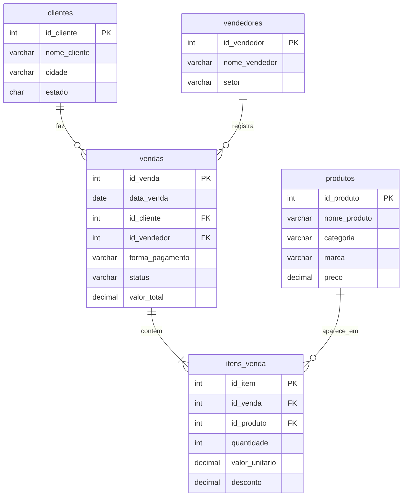

# SQL Class

Repositório de estudos da disciplina de Banco de Dados II (ADS,
Senac PR). Reúne os
exercícios resolvidos, os desafios em grupo e um guia de estudos que
resume, em ordem crescente de dificuldade, tudo que foi praticado ao
longo do curso.

## Cenários usados nos exercícios

A maior parte das aulas usa uma empresa fictícia, a **TechVendas
S/A**, uma loja que vende produtos de informática, telefonia,
eletrodomésticos e outras categorias. O banco tem cinco tabelas
principais:

- `clientes` — id_cliente, nome_cliente, cidade, estado
- `vendedores` — id_vendedor, nome_vendedor, setor
- `produtos` — id_produto, nome_produto, categoria, marca, preco
- `vendas` — id_venda, data_venda, id_cliente, id_vendedor, forma_pagamento, status, valor_total
- `itens_venda` — id_item, id_venda, id_produto, quantidade, valor_unitario, desconto



O desafio final do bimestre troca de cenário para a **SportZone**,
uma loja de artigos esportivos, com uma estrutura parecida (clientes,
vendedores, produtos, vendas, itens_venda) mas com campos próprios,
como `renda` do cliente e `estoque` do produto.

Em ambos os cenários os dados foram montados de propósito com
"furos": clientes que nunca compraram, vendedores sem vendas e
produtos nunca vendidos. Isso é o que torna os exercícios de LEFT
JOIN, EXISTS e auditoria de dados interessantes — sem esses furos não
haveria diferença entre INNER JOIN e LEFT JOIN para observar.

Banco usado nas aulas: MySQL 8+. A maioria das consultas também roda
em PostgreSQL 12+ e SQLite 3+, com pequenos ajustes de sintaxe
apontados nos comentários (principalmente em funções de data e no
FULL OUTER JOIN).

## Estrutura do repositório

Cada pasta é um módulo do curso, numerada na ordem em que foi visto:

```
SQL_class/
├── guia_de_estudos_sql.sql       resumo próprio de todo o conteúdo
├── 01-warming-up/                UPDATE, DELETE, GROUP BY
├── 02-cte/                       exercícios de CTE
├── 03-inner-join/                lista de INNER JOIN (enunciado e respondida)
├── 04-left-join/                 lista de LEFT JOIN (enunciado e respondida)
├── 05-dashboard-executivo/       Challenge Night: 15 KPIs
├── 06-joins-avancados/           Challenge Night Pt2: RIGHT/FULL JOIN, window functions
├── 07-desafio-final-sportzone/   desafio final do bimestre + relatório
├── 08-sql-quest/                 SQL Quest: recuperação da base de jogadores
├── 09-views-techmarket/          VIEWS: camada de consultas reutilizáveis da TechMarket
└── 10-sql-murder-mystery/        SQL Murder Mystery: investigação com JOIN e subconsulta
```

## Módulos do curso

| Pasta | Módulo | Conteúdo | Arquivos |
|---|---|---|---|
| `01-warming-up/` | Warming Up | UPDATE, DELETE, GROUP BY e funções de agregação numa tabela única de vendas | `warming_up.sql` |
| `02-cte/` | Exercícios de CTE | CTE simples, CTEs encadeadas, CTE x subquery | `respostas_cte.sql` |
| `03-inner-join/` | Inner Join | 15 exercícios de INNER JOIN entre 2 a 5 tabelas | `lista_inner_join.sql` (schema + dados + exercícios), `exercicios_inner_join.sql` / `exercicios_inner_join_respondido.sql` |
| `04-left-join/` | Left Join | 15 exercícios de LEFT JOIN (clientes sem compra, vendedores sem venda, produtos sem giro) | `exercicios_left_join.sql`, `exercicios_left_join_respondido.sql` |
| `05-dashboard-executivo/` | Challenge Night — Dashboard Executivo | 15 KPIs de negócio combinando CTE, JOIN, CASE e agregação | `dashboard_executivo_techvendas.sql` |
| `06-joins-avancados/` | Challenge Night Pt2 — JOINs Avançados | Auditoria com CTE, RIGHT JOIN, simulação de FULL OUTER JOIN com UNION, CTEs encadeadas com window function | `noitada_desafios_vol2.sql` |
| — | Between + Exists + In (Missões da Noite) | COALESCE, BETWEEN, IN, LIKE, EXISTS / NOT EXISTS | Não há um arquivo dedicado só com essas 20 missões; `BETWEEN`, `NOT EXISTS` e `CROSS JOIN` acabaram sendo exercitados dentro dos KPIs extras do desafio final (`07-desafio-final-sportzone/`) |
| `07-desafio-final-sportzone/` | Desafio Final do Bimestre — SportZone | Relatório gerencial completo (clientes, produtos, vendedores) + 10 KPIs obrigatórios + 5 KPIs próprios | `DDL_desafio_final.sql` (schema + dados), `desafio_final_sportzone.sql` (consultas), `Relatorio_SportZone_Desafio_Final.docx` (resultados e interpretação) |
| `08-sql-quest/` | SQL Quest — O Ataque ao Reino dos Dados | Recuperação em 7 etapas encadeadas de uma base de jogadores: UPDATE com CASE, COALESCE, subquery com AVG, GROUP BY + HAVING dentro de subquery, UPDATE com ORDER BY/LIMIT, SELECT de conferência antes de UPDATE/DELETE | `DDL_sql_quest.sql` (schema + dados fornecidos), `sql_quest_reino_dos_dados.sql` (etapas + auditoria final) |
| `09-views-techmarket/` | Views — TechMarket (14/10) | 4 VIEWS (vendas detalhadas, vendedores, produtos, clientes), painel executivo combinando VIEWS, atualização da view de vendedores com desconto total, questões técnicas e parecer gerencial | `DDL_techmarket.sql` (schema + dados fornecidos), `views_techmarket.sql` (views, relatórios e respostas) |
| `10-sql-murder-mystery/` | Desafio da Noite — SQL Murder Mystery (14/11) | Investigação no banco do jogo (SQLite) com WHERE, LIKE, INNER/LEFT JOIN, subconsulta, GROUP BY + HAVING; assassino e mandante confirmados pelo próprio jogo | `sql_murder_mystery.sql` (consultas, evidências e conclusão) |
| Repositório [spotify-dashboard-looker](https://github.com/PeSzpak/spotify-dashboard-looker) | Datathon (21/10) | Dashboard no Looker Studio com 15 KPIs sobre o Top 50 do Spotify | Projeto próprio, com SQL, scripts e prints |
| Repositório [arquitetura-medalhao-mysql](https://github.com/PeSzpak/arquitetura-medalhao-mysql) | Hands-on Medalhão (11/11) | Stored Procedures Bronze → Silver → Gold com transação, tabela temporária e reexecução sem duplicar; README com data lake, swamp, warehouse e lakehouse | Projeto próprio |

`guia_de_estudos_sql.sql` não é um exercício da disciplina — é um
resumo próprio, com uma base de dados reduzida, cobrindo cada
conceito acima numa única consulta de exemplo. Serve como ponto de
partida para revisar antes de uma prova ou entrevista.

## Conteúdo estudado, do básico ao avançado

1. **Modelagem e DDL** — `CREATE TABLE`, tipos de dados, `PRIMARY KEY`,
   `FOREIGN KEY`, `AUTO_INCREMENT`, `CHECK`, `DROP TABLE` respeitando
   a ordem de dependência, `CREATE INDEX` nas colunas usadas em JOIN.
2. **Manipulação de dados** — `INSERT INTO`, `UPDATE` e `DELETE`,
   sempre com `WHERE` para não afetar a tabela inteira.
3. **Consultas básicas** — `SELECT` de colunas específicas (sem
   `SELECT *`), `WHERE`, `ORDER BY`, alias de tabela com `AS`.
4. **Agregação** — `COUNT`, `SUM`, `AVG`, `MIN`, `MAX`, `GROUP BY` e
   `HAVING` (filtro sobre o grupo já agregado, diferente do `WHERE`).
5. **INNER JOIN** — junção entre duas, três e até cinco tabelas ao
   mesmo tempo, sempre com alias e a condição no `ON`.
6. **LEFT JOIN** — preservar todas as linhas da tabela da esquerda,
   usar `IS NULL` para encontrar quem não tem correspondência
   (cliente sem compra, produto nunca vendido) e `COALESCE` para
   trocar `NULL` por zero em somas e contagens.
7. **RIGHT JOIN e simulação de FULL OUTER JOIN** — MySQL não tem
   `FULL OUTER JOIN` nativo; a solução usada foi somar um `LEFT JOIN`
   com um `RIGHT JOIN` via `UNION`, usada no exercício de fusão de
   duas bases de clientes e também na comparação de cidades x
   categorias sem venda no desafio da SportZone.
8. **BETWEEN, IN, LIKE, EXISTS e NOT EXISTS** — faixa de valores com
   `BETWEEN` (e o equivalente com `>=`/`<=`), lista de valores com
   `IN`, busca por padrão de texto com `LIKE` (`%` antes, depois ou
   nos dois lados), e teste de existência com `EXISTS` / `NOT
   EXISTS` como alternativa ao `LEFT JOIN + IS NULL`.
9. **Subqueries** — subquery escalar em `WHERE`, subquery no `FROM`
   tratada como tabela, subquery correlacionada dentro do `SELECT`.
10. **CTE (`WITH`)** — nomear um passo intermediário antes da consulta
    principal, encadear várias CTEs em sequência, e quando isso é
    mais claro que uma subquery aninhada.
11. **CASE WHEN** — classificação condicional dentro do `SELECT`
    (cliente VIP/Regular/Ocasional, vendedor Excelente/Bom/Regular,
    faixas de renda).
12. **Window functions** — `ROW_NUMBER() OVER (PARTITION BY ... ORDER
    BY ...)` para achar o item de maior valor dentro de cada grupo
    sem colapsar o resultado, como o `GROUP BY` faria.
13. **CROSS JOIN** — combinar todas as linhas de duas tabelas sem
    condição de junção, usado para gerar todas as combinações
    possíveis (por exemplo cidade x categoria) e depois filtrar as
    que nunca tiveram venda com `NOT EXISTS`.
14. **Funções de data** — `DATEDIFF` e `CURDATE()` para calcular
    recência de compra.
15. **Consultas analíticas / dashboards** — combinar CTE, JOIN, CASE
    e agregação numa única consulta para responder perguntas de
    negócio: taxa de conversão de clientes, concentração de receita
    nos maiores clientes, taxa de cancelamento por vendedor,
    faturamento líquido por categoria, produtos com estoque alto e
    baixa saída, comparação entre melhor e pior vendedor.

## Como executar

```bash
mysql -u usuario -p nome_do_banco < guia_de_estudos_sql.sql
```

Os demais arquivos criam o próprio banco (`db_2_bim`,
`db_aula_innerjoin`, `sportzone` ou `sql_quest`, conforme o `CREATE DATABASE`/`USE`
no topo de cada arquivo) — rode o script de schema e dados de cada
módulo antes do script de consultas correspondente. Exemplo:

```bash
mysql -u usuario -p < 07-desafio-final-sportzone/DDL_desafio_final.sql
mysql -u usuario -p < 07-desafio-final-sportzone/desafio_final_sportzone.sql
```

Sem MySQL instalado, um container descartável resolve:

```bash
docker run -d --name sql-class -e MYSQL_ROOT_PASSWORD=senha -e MYSQL_DATABASE=estudos mysql:8.4
# espere uns 20 s até o servidor subir
docker exec -i sql-class mysql -uroot -psenha < 07-desafio-final-sportzone/DDL_desafio_final.sql
docker exec -i sql-class mysql -uroot -psenha -t sportzone < 07-desafio-final-sportzone/desafio_final_sportzone.sql
docker rm -f sql-class   # quando terminar
```

Ordem de execução de cada módulo (testada num MySQL 8.4 limpo):

| Módulo | Rode antes | Depois |
|---|---|---|
| 03, 04, 05 (TechVendas) | `03-inner-join/lista_inner_join.sql` | `exercicios_inner_join_respondido.sql`, `04-left-join/exercicios_left_join_respondido.sql`, `05-dashboard-executivo/dashboard_executivo_techvendas.sql` |
| 06 | `03-inner-join/lista_inner_join.sql` (usa o banco `db_aula_innerjoin` e cria tabelas extras) | `06-joins-avancados/noitada_desafios_vol2.sql` |
| 07 SportZone | `DDL_desafio_final.sql` | `desafio_final_sportzone.sql` |
| 08 SQL Quest | `DDL_sql_quest.sql` | `sql_quest_reino_dos_dados.sql` |
| 09 TechMarket | `DDL_techmarket.sql` | `views_techmarket.sql` |
| Guia | qualquer banco vazio (`estudos`) | `guia_de_estudos_sql.sql` |

`01-warming-up/` e `02-cte/` usam a tabela `vendas` do banco da aula
(com `status_venda`), que não está neste repositório, então não rodam
sozinhos. `03-inner-join/exercicios_inner_join.sql` usa o banco
`db_2_bim`, que precisa existir antes (`CREATE DATABASE db_2_bim;`).
`10-sql-murder-mystery/` roda no banco SQLite do próprio jogo
([SQL Murder Mystery](https://mystery.knightlab.com/)).

Exemplo de saída, KPI 11 da SportZone (concentração de faturamento nos
3 maiores clientes):

```
+------------------+----------------------------+-----------------+
| faturamento_top3 | faturamento_total_clientes | percentual_top3 |
+------------------+----------------------------+-----------------+
|         13916.10 |                   27777.20 |           50.10 |
+------------------+----------------------------+-----------------+
```
